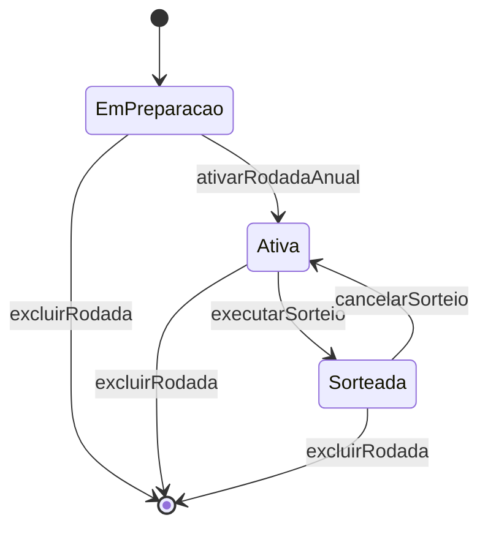

# Spec — MVP sorteio de vagas de estacionamento

**Status:** rascunho para aprovação do PO  
**Versão:** 0.1  
**Data:** 2026-03-10  
**Pre-spec:** [`1-pre-spec.md`](./1-pre-spec.md)

> Especificação **testável** do MVP. Não contradiz a pre-spec. Implementação só após aprovação desta spec (checklist §12).

---

## 1. Resumo

Painel administrativo (pt-BR) para cadastro de **36 unidades** e **72 lugares físicos** de estacionamento, condução de **rodada anual**, **atribuições manuais** pré-sorteado, **sorteio** com regras de gaveta/cobertura e **exportação** CSV/PDF. Autenticação: **um** administrador.

---

## 2. Modelo de domínio (conceitos)

| Entidade | Atributos MVP | Regras |
|----------|---------------|--------|
| **Unidade** | `numero` (string única, ex. `101`) | 36 unidades no condomínio de referência; cadastro pode crescer, regras de rodada anual exigem **todas as unidades cadastradas** inscritas. |
| **Vaga** | `codigo` (único), `tipo`: `Simples` \| `Gaveta`, `cobertura`: `Coberta` \| `Descoberta`, `ehPcd` (bool) | Gaveta consome **2** lugares físicos no inventário; simples consome **1**. |
| **Rodada** | `ano` (int, único por rodada anual), `estado`, datas de criação/sorteio | Foco MVP: **anual**. |
| **Inscrição** | `rodadaId`, `unidadeId` | Rodada anual: **todas** as unidades existentes no cadastro ao ativar a rodada. |
| **Atribuição** | `rodadaId`, `unidadeId`, `vagaId`, `origem`: `Manual` \| `Sorteio` | Mesma vaga **no máximo uma** unidade por rodada. |
| **Execução de sorteio** | `rodadaId`, `sequencia` (1, 2, …), `seed`, `executadoEm` | Cada sorteio bem-sucedido incrementa `sequencia`; cancelamento não apaga histórico de execuções. |

### 2.1 Lugares físicos

- Capacidade total = soma sobre vagas cadastradas: `Simples → 1`, `Gaveta → 2`.
- Meta de referência do condomínio: **72** lugares; o sistema **deve** impedir sorteio se capacidade cadastrada ≠ lugares necessários para contemplar 2× unidades inscritas (validação §6.3).

### 2.2 Direito por unidade na rodada

Cada unidade inscrita tem direito a **2 lugares físicos** na rodada, satisfeitos por:

| Origem | Como conta |
|--------|------------|
| Manual gaveta | 2 lugares, unidade **encerrada** para sorteio |
| Manual 1 simples | 1 lugar, **1 pendente** para sorteio |
| Manual 2 simples | 2 lugares, unidade **encerrada** |
| Sorteio forma A | 1 gaveta coberta elegível → 2 lugares, encerrada |
| Sorteio forma B | 2 simples distintas, ≥1 coberta → 2 lugares, encerrada |
| Sorteio complemento | 1 simples quando restar **1** pendente (após manual parcial) |

**Proibido na mesma rodada, mesma unidade:** gaveta + simples (manual ou sorteio combinados).

---

## 3. Máquina de estados da rodada

| Estado | Permite |
|--------|---------|
| **EmPreparacao** | Editar metadados da rodada (ex. ano); ainda **não** inscreve unidades automaticamente. |
| **Ativa** | Inscrições fixas (36/todas unidades); atribuições **manuais**; executar sorteio; export **somente** se já sorteada (ver §8). |
| **Sorteada** | Visualizar resultado; export; **cancelar sorteio** (volta `Ativa`, mantém manuais); **excluir** a rodada; **não** permite novo sorteio sem cancelar ou concluir fluxo de re-sorteio. |

**Re-sorteio:** em `Sorteada`, `cancelarSorteio` remove atribuições com `origem = Sorteio`, preserva `Manual`, registra evento de cancelamento, estado → `Ativa`. Nova execução gera nova `Execução de sorteio` com `sequencia` incrementada.

**Exclusão:** em qualquer estado, `excluirRodada` remove a rodada e vínculos (inscrições, atribuições, execuções, cancelamentos). Unidades e vagas **não** são apagadas. O `ano` volta a ficar disponível.

---

## 4. Status de contemplação por unidade (pós-sorteio)

Calculado **após** cada execução de sorteio (manuais + sorteio):

| Status | Condição |
|--------|----------|
| **Completa** | Exatamente **2** lugares físicos atribuídos **e** ≥1 vaga/registro com cobertura `Coberta` **ou** exceção PCD documentada (§4.1). |
| **Parcial** | **1** lugar atribuído (só manual ou sorteio interrompido por falta de pool). |
| **NaoContemplada** | **0** lugares atribuídos. |
| **CompletaSemCobertura** | 2 lugares atribuídos mas **nenhuma** coberta — **não** deve ser produzido como resultado “válido” de sorteio automático; se surgir só via combinação manual inválida, bloquear **antes** do sorteio (§6.2). |

A UI e o export **devem** exibir o `status` por unidade quando ≠ `Completa`.

### 4.1 Exceção PCD (mínimo 1 coberta)

**WHEN** a unidade possui atribuição manual nas **2** vagas marcadas `ehPcd = true` **THEN** o status **SHALL** ser `Completa` **even if** ambas forem `Descoberta` (convenção acordada na pre-spec).

**WHEN** a unidade não está no par PCD manual completo **THEN** a regra ≥1 coberta **SHALL** aplicar-se normalmente.

---

## 5. Pool elegível

Para uma rodada em estado `Ativa`, imediatamente antes de sortear cada unidade:

**Pool** = vagas cadastradas  
− vagas com atribuição manual (qualquer unidade)  
− vagas já consumidas por sorteio nesta execução  

Subconjuntos usados pelo algoritmo:

- **Gavetas forma A:** gavetas no pool com `cobertura = Coberta`.
- **Simples forma B:** pares distintos `(s1, s2)` no pool tais que `s1 ≠ s2` e (`s1.Coberta` ou `s2.Coberta`).
- **Simples complemento (1 pendente):** simples no pool; se a manual existente for `Descoberta`, restringir a simples `Coberta`; se manual for `Coberta`, qualquer simples no pool.

**Gavetas descobertas** permanecem no pool físico mas **SHALL NOT** entrar em forma A.

---

## 6. Algoritmo de sorteio

### 6.1 Princípios

1. **Ordem das unidades:** ao iniciar a execução, gerar `seed` criptograficamente adequado (ex. 256 bits), derivar permutação **uniforme** das unidades **elegíveis** (pendência > 0 e sem violação de proibição gaveta+simples).
2. **Por unidade**, na ordem permutada, sortear **uma** opção **uniformemente** entre todas as opções **legalmente elegíveis** dado o pool **atual** (não apenas “escolher forma A ou B”).
3. **Consumo:** ao atribuir gaveta, remover **1** registro gaveta do pool; ao atribuir simples, remover esse registro.
4. **Parada:** unidades sem pendência ou sem opções elegíveis ficam com status final conforme §4 (parcial/não contemplada).
5. **Reprodutibilidade:** persistir `seed`, ordem das unidades, `sequencia` e lista de opções sorteadas (ids de vaga(s)) por unidade na `Execução de sorteio`.

### 6.2 Unidade elegível ao sorteio automático

| Pendência (lugares) | Opções elegíveis |
|---------------------|------------------|
| 0 | Ignorar (já encerrada). |
| 2 | União: todas forma A (gaveta coberta no pool) + todas forma B (pares simples válidos). Se conjunto vazio → não contemplada ou parcial conforme já atribuído. |
| 1 | Todas simples elegíveis do complemento (§5). **Nunca** gaveta. |

**WHEN** unidade tem manual gaveta **THEN** pendência 0 **AND** **SHALL NOT** participar do sorteio.

**WHEN** unidade tem manual 1 simples **THEN** pendência 1 **AND** **SHALL NOT** receber gaveta no sorteio.

**WHEN** admin tenta manual que mistura gaveta e simples na mesma unidade/rodada **THEN** sistema **SHALL** rejeitar com erro de validação.

**WHEN** admin tenta manual que levaria unidade a `CompletaSemCobertura` sem ser par PCD §4.1 **THEN** sistema **SHALL** rejeitar **before** sorteio (validação bloqueante).

### 6.3 Validações pré-sorteado

| Tipo | Comportamento |
|------|----------------|
| **Bloqueante** | Rodada não `Ativa`; unidade não inscrita; vaga duplicada; mistura gaveta+simples; manual PCD inconsistente; capacidade física cadastrada < 2 × unidades inscritas; tentativa de sorteio com 0 unidades inscritas. |
| **Aviso (não bloqueante)** | Contagem de cobertas no pool aparentemente insuficiente para completar todas as unidades pendentes; contagem de gavetas cobertas + pares simples possíveis abaixo do número de unidades com pendência 2. Exibir na UI; permitir sorteio (parcial explícito). |

### 6.4 Uniformidade (testável)

**WHEN** duas opções distintas `o1` e `o2` são elegíveis para a mesma unidade no mesmo passo com o mesmo pool **THEN** a probabilidade de escolher `o1` **SHALL** equalar a de `o2` (testes estatísticos com seed fixo para passos determinísticos; testes de contagem de opções para passos com pool pequeno).

---

## 7. Requisitos EARS

Legenda: **Ubiquitous** (sempre), **WHEN/THEN** (evento), **IF/THEN** (estado indesejado opcional).

### 7.1 Cadastro

- **Ubiquitous:** O sistema **SHALL** exigir `numero` único por unidade e `codigo` único por vaga.
- **WHEN** admin cadastra vaga com `tipo = Gaveta` **THEN** o inventário **SHALL** contabilizar **2** lugares físicos para essa vaga.
- **WHEN** admin marca `ehPcd = true` **THEN** no máximo **2** vagas no cadastro **MAY** ter `ehPcd` simultaneamente (validação alinhada ao condomínio de referência; alerta se >2).

### 7.2 Rodada anual

- **WHEN** admin ativa rodada anual **THEN** o sistema **SHALL** inscrever **todas** as unidades cadastradas na rodada.
- **WHEN** rodada está `Sorteada` **THEN** atribuições manuais **SHALL NOT** ser editáveis sem cancelar sorteio primeiro.
- **WHEN** admin exclui uma rodada **THEN** o sistema **SHALL** removê-la com inscrições, atribuições, execuções e cancelamentos; unidades e vagas cadastradas **SHALL NOT** ser removidas.

### 7.3 Atribuição manual

- **WHEN** admin atribui vaga manualmente **THEN** essa vaga **SHALL** sair do pool do sorteio.
- **WHEN** vaga já está atribuída (manual ou sorteio) a outra unidade na mesma rodada **THEN** o sistema **SHALL** rejeitar nova atribuição.

### 7.4 Sorteio

- **WHEN** sorteio concluído com sucesso **THEN** nenhuma vaga **SHALL** aparecer em mais de uma unidade na mesma rodada.
- **WHEN** sorteio atribui forma B **THEN** as duas simples **SHALL** ser distintas e ≥1 coberta.
- **WHEN** sorteio atribui forma A **THEN** a gaveta **SHALL** ser `Coberta`.
- **IF** unidade ficar com 2 lugares e nenhuma coberta sem exceção §4.1 **THEN** o sistema **SHALL NOT** marcar sorteio como sucesso integral (bloquear cenário via validações §6.2–6.3).

### 7.5 Cancelamento e re-sorteio

- **WHEN** admin cancela sorteio **THEN** atribuições `origem = Sorteio` **SHALL** ser removidas, manuais **SHALL** permanecer, estado **SHALL** ser `Ativa`, e evento **SHALL** registrar `executadoEm`, `sequencia` cancelada e usuário/sessão.
- **WHEN** admin executa novo sorteio após cancelamento **THEN** `sequencia` **SHALL** incrementar e resultado anterior de sorteio **SHALL NOT** aparecer como vigente.

### 7.6 Exportação

- **WHEN** admin exporta CSV ou PDF **THEN** arquivo **SHALL** listar todas as unidades inscritas com colunas mínimas §8 e status §4.
- **WHEN** unidade tem gaveta contemplada **THEN** export **SHALL** usar **uma linha** por unidade–vaga registro, com coluna `lugares_fisicos = 2`.

### 7.7 Autenticação

- **Ubiquitous:** Endpoints e páginas admin **SHALL** exigir sessão autenticada.
- **WHEN** credenciais inválidas **THEN** login **SHALL** falhar sem revelar qual campo falhou (mensagem genérica pt-BR).
- **WHEN** sessão expirada **THEN** UI **SHALL** redirecionar para login.

### 7.8 Campos fora do MVP

- **Ubiquitous:** Cadastro de unidade **SHALL NOT** incluir bloco, placa ou nome de morador no MVP.

---

## 8. Formato de exportação

### 8.1 CSV (UTF-8, separador `;` — locale pt-BR)

Colunas obrigatórias:

| Coluna | Descrição |
|--------|-----------|
| `ano_rodada` | Ano da rodada |
| `unidade` | Número do apartamento |
| `status_contemplacao` | `Completa` \| `Parcial` \| `NaoContemplada` \| `CompletaSemCobertura` |
| `vaga_codigo` | Código da vaga (vazio se não contemplada) |
| `tipo_vaga` | `Simples` \| `Gaveta` \| vazio |
| `cobertura` | `Coberta` \| `Descoberta` \| vazio |
| `lugares_fisicos` | `1`, `2` ou `0` |
| `origem` | `Manual` \| `Sorteio` \| vazio |

**WHEN** unidade tem 2 simples **THEN** **2 linhas** (mesmo `unidade`, `vaga_codigo` distintos).  
**WHEN** unidade tem gaveta **THEN** **1 linha** com `lugares_fisicos = 2`.

Nome de arquivo sugerido: `sorteio-{ano}-v{sequencia}.csv`.

### 8.2 PDF

Documento legível para assembleia: título com ano e data do sorteio, tabela com mesmas colunas (exceto pode omitir `origem` se layout apertado — **preferível manter**), totais: unidades completas / parciais / não contempladas, rodapé com `sequencia` e data/hora da execução.

**OUT:** seed, lista completa de participantes estilo ata, hash público — fora do MVP (pre-spec §7).

---

## 9. Autenticação (detalhe técnico MVP)

| Aspecto | Decisão MVP |
|---------|-------------|
| Identidade | **Um** usuário admin |
| Credenciais | Configuração de ambiente (`ADMIN_USERNAME`, `ADMIN_PASSWORD` ou hash `ADMIN_PASSWORD_HASH`) |
| Senha | Armazenada como hash (ex. ASP.NET Identity PasswordHasher ou BCrypt); **sem** tela de troca de senha |
| Sessão | Cookie HTTP-only, SameSite=Lax; expiração configurável (padrão 8h) |
| API | Login emite sessão; demais rotas admin `[Authorize]` |

---

## 10. Auditoria mínima

Persistir:

- Cada `Execução de sorteio`: `sequencia`, `seed`, `executadoEm`, snapshot JSON compacto `{ unidadeId, vagaIds[], origem }`.
- Cada cancelamento: referência à `sequencia` cancelada, `canceladoEm`.

**SHALL NOT** exigir UI de auditoria além de indicar na tela da rodada “Sorteio #N” e data.

---

## 11. Histórias de usuário (MVP)

| ID | Como síndico… | Critério de aceite |
|----|----------------|-------------------|
| US-01 | … quero cadastrar unidades e vagas | CRUD mínimo; gaveta conta 2 lugares no total exibido |
| US-02 | … quero abrir a rodada anual | Todas unidades inscritas; estado `Ativa` |
| US-03 | … quero fixar vagas PCD antes do sorteio | Manual remove vaga do pool; par PCD completo não entra no sorteio |
| US-04 | … quero executar o sorteio | Resultado obedece §6; status por unidade visível |
| US-05 | … quero cancelar e sortear de novo | Só sorteio anterior some; manuais ficam; sequencia incrementa |
| US-06 | … quero exportar CSV/PDF | Arquivo conforme §8 |
| US-07 | … quero acesso protegido | Sem login não acessa painel |
| US-08 | … quero excluir uma rodada | Some a rodada e vínculos; cadastro de unidades/vagas permanece; ano pode ser recriado |

---

## 12. Falhas e mensagens (pt-BR)

| Código lógico | Situação | HTTP sugerido |
|---------------|----------|---------------|
| `AUTH_INVALID` | Login falhou | 401 |
| `AUTH_REQUIRED` | Sem sessão | 401 |
| `RODADA_ESTADO_INVALIDO` | Ação fora do estado | 409 |
| `VAGA_INDISPONIVEL` | Duplicidade ou vaga fora do pool | 409 |
| `MANUAL_REGRA_VIOLADA` | Gaveta+simples ou cobertura | 422 |
| `SORTEIO_BLOQUEADO` | Validação bloqueante §6.3 | 422 |
| `CAPACIDADE_INSUFICIENTE` | Lugares cadastrados < 2× unidades | 422 |

Mensagens **SHALL** ser claras para o síndico (sem jargão de stack trace na UI).

---

## 13. Checklist de aprovação (PO + time)

Marque antes de iniciar implementação por slices:

- [ ] Pre-spec §13 aprovada pelo PO
- [ ] Algoritmo §6 e status §4 aceitos (incl. manual parcial e PCD)
- [ ] Formato export §8 aceito para assembleia
- [ ] Decisões de sessão §9 aceitas (sem troca de senha na UI)
- [ ] Escopo OUT da pre-spec §7 reconfirmado
- [ ] Esta spec **versão 0.1** assinada/aprovada

| Papel | Nome | Data | Aprovado? |
|-------|------|------|-----------|
| PO / Síndico | | | ☐ |
| Tech lead | | | ☐ |

---

## 14. Rastreabilidade pre-spec → spec

| Pre-spec § | Spec |
|------------|------|
| 6.1 Cadastro | §2, §7.1 |
| 6.2 Auth | §9, §7.7 |
| 6.3 Rodada | §3, §7.2 |
| 6.4 Manual | §2.2, §5, §7.3, §6.2 |
| 6.5 Sorteio | §5, §6, §7.4 |
| 6.6 Export | §8, §7.6 |
| 6.7 Auditoria | §10, §7.5 |
| 11 Pendências 1–9 | §6, §4, §8, §9, §10, §7.8 |

---

## 15. Próximo passo SDD

Após aprovação: opcional `plan.md` (slices, contratos API, telas) **nesta pasta**, depois implementação com **TDD obrigatório** para sorteio e invariantes de rodada (`AGENTS.md`).
