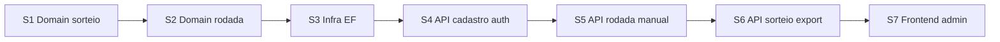

# Plan — MVP sorteio de vagas (`docs/001-mvp`)

**Status:** rascunho para aprovação do PO / tech  
**Versão:** 0.1  
**Data:** 2026-03-10  
**Base:** [`1-pre-spec.md`](./1-pre-spec.md), [`2-spec.md`](./2-spec.md), [`AGENTS.md`](../../AGENTS.md)

> Plano técnico de implementação em **slices**. Código só após aprovação deste plano + spec §13.

---

## 1. Estrutura de repositório (monorepo)

```text
sorteio-estacionamento-condominio/
├── AGENTS.md
├── docs/001-mvp/
├── backend/
│   ├── SorteioEstacionamento.sln
│   ├── src/
│   │   ├── SorteioEstacionamento.Domain/
│   │   ├── SorteioEstacionamento.Application/
│   │   ├── SorteioEstacionamento.Infrastructure/
│   │   └── SorteioEstacionamento.Api/
│   └── tests/
│       ├── SorteioEstacionamento.Domain.Tests/
│       └── SorteioEstacionamento.Application.Tests/
└── frontend/                    # Next.js App Router
```

---

## 2. Visão de camadas (DDD)

| Camada | Responsabilidade MVP |
|--------|----------------------|
| **Domain** | Entidades, enums, invariantes, `MotorSorteio`, pool elegível, cálculo de status de contemplação, validações manuais (spec §4–§6) |
| **Application** | Use cases (commands/queries), orquestração rodada (estados §3), DTOs, interfaces de repositório |
| **Infrastructure** | EF Core, SQLite, repositórios, hash senha admin, export CSV/PDF |
| **Api** | REST + auth cookie, Swagger dev, CORS para Next |

---

## 3. Slices (ordem de entrega)



| Slice | Objetivo | Testes esperados |
|-------|----------|------------------|
| **S1** | Núcleo do sorteio (sem persistência) | Domain.Tests: §6, §4, §5 |
| **S2** | Agregados + máquina de estados + validações pré-sorteado | Domain.Tests + Application.Tests leves |
| **S3** | Persistência e migrations | Smoke integração (opcional) |
| **S4** | Login + CRUD unidades/vagas | Application.Tests + API manual |
| **S5** | Rodada anual, inscrições, atribuições manuais | Application.Tests |
| **S6** | Executar/cancelar sorteio, export, auditoria mínima | Application.Tests + 1 teste integração sorteio |
| **S7** | UI admin fluxo completo | E2E manual (Playwright opcional pós-MVP) |

---

## 4. Slice 1 — Domain + testes do sorteio (primeiro código)

**Escopo IN:** spec §5, §6, §4 (status), §2.2 (pendência), **sem** API, EF, Next.

**Escopo OUT deste slice:** auth, export, UI, persistência, cancelamento/re-sorteio (S2/S6).

### 4.1 Tipos de domínio (sugestão)

- `TipoVaga`, `CoberturaVaga`, `OrigemAtribuicao`, `StatusContemplacao`
- `VagaSnapshot` (codigo, tipo, cobertura, ehPcd) — imutável para motor
- `AtribuicaoSnapshot` (unidadeId, vaga(s), origem)
- `UnidadeSorteioContext` (unidadeId, atribuições manuais, pendência em lugares)
- `OpcaoSorteio` (forma A gaveta | forma B par simples | complemento 1 simples)
- `ResultadoSorteioUnidade`, `ResultadoExecucaoSorteio` (seed, ordem unidades, atribuições sorteio)

### 4.2 Serviços / componentes

| Componente | Função |
|------------|--------|
| `CalculadorLugaresFisicos` | Simples=1, Gaveta=2 |
| `CalculadorPendencia` | 2 − lugares já atribuídos; regras manual gaveta/2 simples |
| `ValidadorAtribuicaoManual` | proíbe gaveta+simples; bloqueia `CompletaSemCobertura` sem PCD §4.1 |
| `PoolElegivel` | spec §5 — subconjuntos forma A/B/complemento |
| `MotorSorteio` | seed → permutação unidades → escolha uniforme entre opções legais → consumo pool |
| `CalculadorStatusContemplacao` | spec §4 pós-execução |

### 4.3 Casos de teste obrigatórios (TDD)

1. Forma A só gaveta **Coberta**; gaveta descoberta excluída de A.
2. Forma B: duas simples distintas, ≥1 coberta.
3. Complemento: pendência 1; nunca gaveta; restrição coberta se manual descoberta.
4. Unidade com manual gaveta não entra no sorteio.
5. Unidade com 2 simples manuais encerrada.
6. Mesma vaga não atribuída duas vezes na execução.
7. Seed fixo → resultado reprodutível (determinismo).
8. Duas opções elegíveis no mesmo passo → contagem igual de opções (uniformidade estrutural).
9. Pool esgotado → unidade `Parcial` ou `NaoContemplada` conforme §4.
10. Exceção PCD §4.1 (2 vagas PCD descobertas → `Completa`).

**Prompt sugerido (Agent, slice 1):**

```text
Slice S1 conforme docs/001-mvp/3-plan.md §4 e 2-spec.md §4–§6.
Criar backend/ com Domain + Domain.Tests apenas.
Implementar MotorSorteio e testes listados em 3-plan.md §4.3.
Sem Application, Infrastructure, Api, frontend.
```

---

## 5. Slice 2 — Domain rodada + Application (orquestração)

**Escopo:** spec §3 (estados), §6.2–§6.3 (elegibilidade, bloqueios/avisos), §7.2–§7.3.

- Entidade `Rodada` + transições `EmPreparacao` → `Ativa` → `Sorteada` → cancelamento → `Ativa`
- Use cases (Application): `AtivarRodadaAnual` (inscreve todas unidades), `AtribuirVagaManual`, `RemoverAtribuicaoManual`
- Validadores bloqueantes §6.3 (capacidade 2× unidades, duplicidade vaga)
- **Ainda sem** HTTP e EF (repositórios in-memory nos testes)

**Testes:** transição inválida; manual em rodada `Sorteada` bloqueado; avisos não bloqueantes (retorno estruturado).

---

## 6. Slice 3 — Infrastructure (EF Core + SQLite)

**Escopo:** mapeamento entidades spec §2, migrations, repositórios.

Tabelas principais: `Unidades`, `Vagas`, `Rodadas`, `Inscricoes`, `Atribuicoes`, `ExecucoesSorteio`, `EventosCancelamento` (auditoria §10).

Seed dev opcional: 36 unidades + inventário exemplo (não obrigatório no slice).

---

## 7. Slice 4 — API: auth + cadastro

### Endpoints

| Método | Rota | Spec |
|--------|------|------|
| POST | `/api/auth/login` | §9, §7.7 |
| POST | `/api/auth/logout` | §9 |
| GET/POST/PUT/DELETE | `/api/unidades` | §7.1, US-01 |
| GET/POST/PUT/DELETE | `/api/vagas` | §7.1, US-01 |
| GET | `/api/inventario/resumo` | lugares físicos totais (§2.1) |

**Frontend (início S7 parcial):** layout admin, login, CRUD unidades/vagas.

---

## 8. Slice 5 — API: rodada e manuais

| Método | Rota | Spec |
|--------|------|------|
| POST | `/api/rodadas` | criar (ano único) |
| DELETE | `/api/rodadas/{id}` | excluir (qualquer estado; cascade) |
| POST | `/api/rodadas/{id}/ativar` | §7.2, US-02 |
| GET | `/api/rodadas/{id}` | detalhe + inscrições + atribuições + avisos §6.3 |
| POST | `/api/rodadas/{id}/atribuicoes-manuais` | §7.3, US-03 |
| DELETE | `/api/rodadas/{id}/atribuicoes-manuais/{atribuicaoId}` | |

---

## 9. Slice 6 — API: sorteio, cancelamento, export

| Método | Rota | Spec |
|--------|------|------|
| POST | `/api/rodadas/{id}/sorteio/executar` | §6, §7.4, US-04 |
| POST | `/api/rodadas/{id}/sorteio/cancelar` | §7.5, US-05 |
| GET | `/api/rodadas/{id}/export/csv` | §8.1, US-06 |
| GET | `/api/rodadas/{id}/export/pdf` | §8.2, US-06 |

Use cases chamam `MotorSorteio` (S1) e persistem `ExecucaoSorteio` §10.

**Testes:** integração feliz 3 unidades / poucas vagas; re-sorteio incrementa `sequencia`; cancelamento remove só `Origem=Sorteio`.

---

## 10. Slice 7 — Frontend admin (fluxo completo)

Telas (pt-BR):

1. Login  
2. Unidades / Vagas (CRUD) + resumo inventário  
3. Rodadas — lista e criar ano  
4. Detalhe rodada — inscrições (read-only), manuais, avisos pré-sorteado  
5. Executar sorteio / cancelar (confirmação)  
6. Resultado + status por unidade + export CSV/PDF  

**Stack:** Tailwind, fetch ou React Query, cookie credentials.

**Critério de done MVP:** fluxo pre-spec §8 sem planilha paralela.

---

## 11. Dependências entre slices

| Bloqueia | Bloqueado por |
|----------|----------------|
| S2 | S1 (motor estável) |
| S3 | S2 (modelo estável) |
| S4–S6 | S3 |
| S6 | S1 + S5 |
| S7 | S4 mínimo; S5–S6 para fluxo completo |

---

## 12. Riscos técnicos (mitigação)

| Risco | Mitigação |
|-------|-----------|
| Algoritmo §6 complexo | S1 só Domain.Tests; não avançar S6 sem cobertura S1 |
| Explosão combinatória forma B | Representar opções como lista explícita no passo; testes com pools pequenos |
| EF vs regras gaveta | Lugares físicos sempre via domínio, não só coluna SQL |

---

## 13. Checklist de aprovação do plano

- [ ] S1 limitado a Domain (sem “já criar API”)
- [ ] Ordem S1→S7 aceita
- [ ] Endpoints suficientes para US-01–US-07
- [ ] PO aceita priorizar sorteio testado antes de UI polida

| Papel | Aprovado? |
|-------|-----------|
| PO | ☐ |
| Dev | ☐ |

---

## 14. Próximo passo

Após aprovação: **implementar Slice S1** (prompt §4.3). Uma conversa = S1 completo + `dotnet test` verde.
